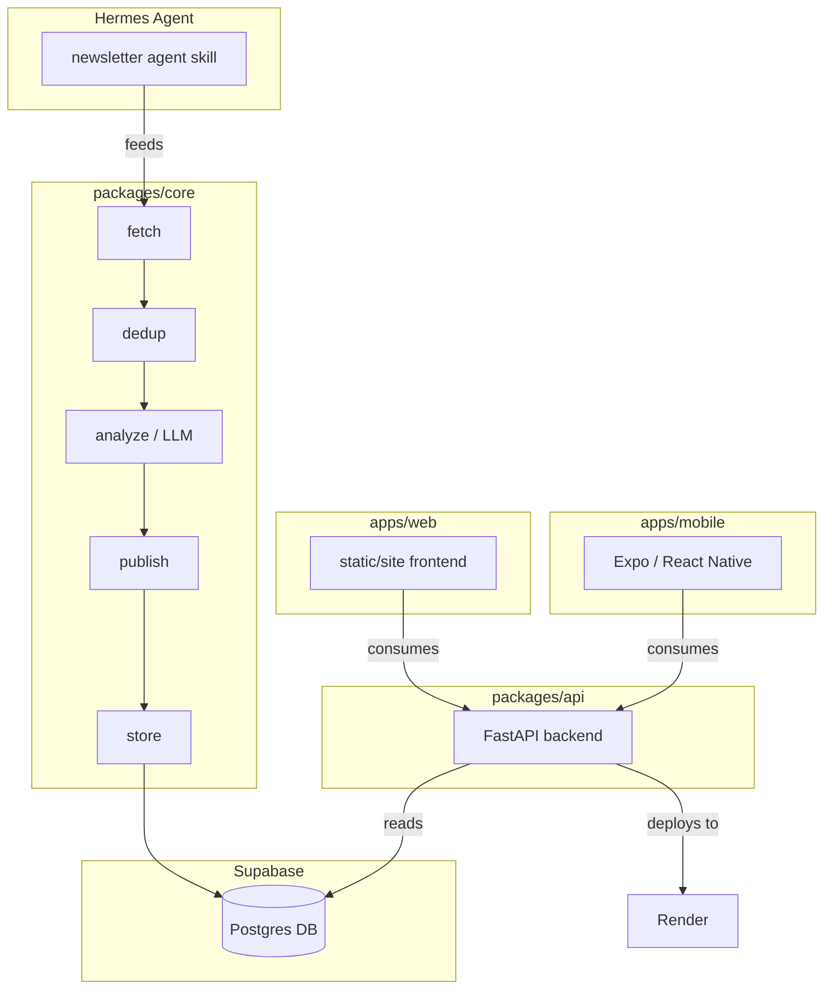

# MedTech & AI — Modular Architecture

## Modules

| Module  | Path              | Responsibility                                  | Language       |
|---------|-------------------|--------------------------------------------------|----------------|
| core    | `packages/core`   | Data-engine pipeline: fetch → dedup → LLM → store | Python         |
| api     | `packages/api`    | REST/GraphQL backend, reads Supabase             | Python (FastAPI) |
| web     | `apps/web`        | Static/doc site frontend                         | JavaScript/TS  |
| mobile  | `apps/mobile`     | Cross-platform mobile client                     | TypeScript (Expo/RN) |
| infra   | `infra/`          | IaC, DB migrations, CI/CD                        | YAML / SQL     |
| hermes  | `hermes/`         | Agent-driven newsletter ingestion and triggers   | Python         |

## Core Submodules

| File                                   | Class / Export     | Responsibility                            |
|----------------------------------------|--------------------|-------------------------------------------|
| `packages/core/medtech_core/config.py` | —                  | Central configuration and env loading     |
| `packages/core/medtech_core/feeds.py`  | —                  | RSS/Atom feed definitions and parsing     |
| `packages/core/medtech_core/fetch.py`  | `DataFetcher`      | Ingest raw articles from configured feeds |
| `packages/core/medtech_core/dedup.py`  | `SemanticDeduper`  | Remove duplicate/similar articles via embeddings |
| `packages/core/medtech_core/analyze.py`| `AIProcessor`      | LLM-based summarization, tagging, extraction |
| `packages/core/medtech_core/publish.py`| `Publisher`        | Format and route output to destinations   |
| `packages/core/medtech_core/store/sqlite.py` | `DatabaseManager` | Local SQLite write-path and query interface |
| `packages/core/medtech_core/store/supabase.py`| `SupabaseStore`   | Cloud Supabase write-path and sync        |
| `packages/core/medtech_core/pipeline.py`| —                  | Orchestrates the end-to-end fetch→store flow |

## Roadmap

1. **Phase 1 — Core refactor**: Extract and modularize the data pipeline under `packages/core` while keeping the live newsletter agent operational on the current schedule.
2. **Phase 2 — FastAPI backend**: Build the `packages/api` service reading from Supabase; deploy to Render behind the monorepo root.
3. **Phase 3 — Expo mobile app**: Scaffold `apps/mobile` with Expo / React Native, consuming the live API for push-notification briefings.
4. **Phase 4 — Web platform enhancement**: Evolve `apps/web` into a full dashboard with search, archives, and user preferences.
